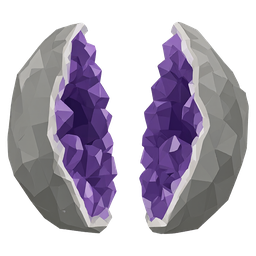
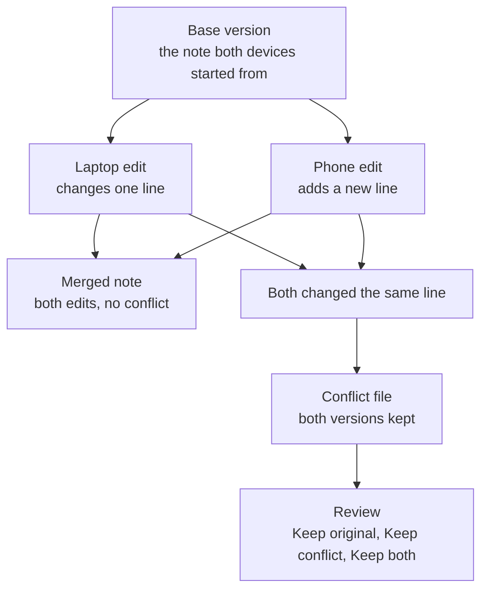
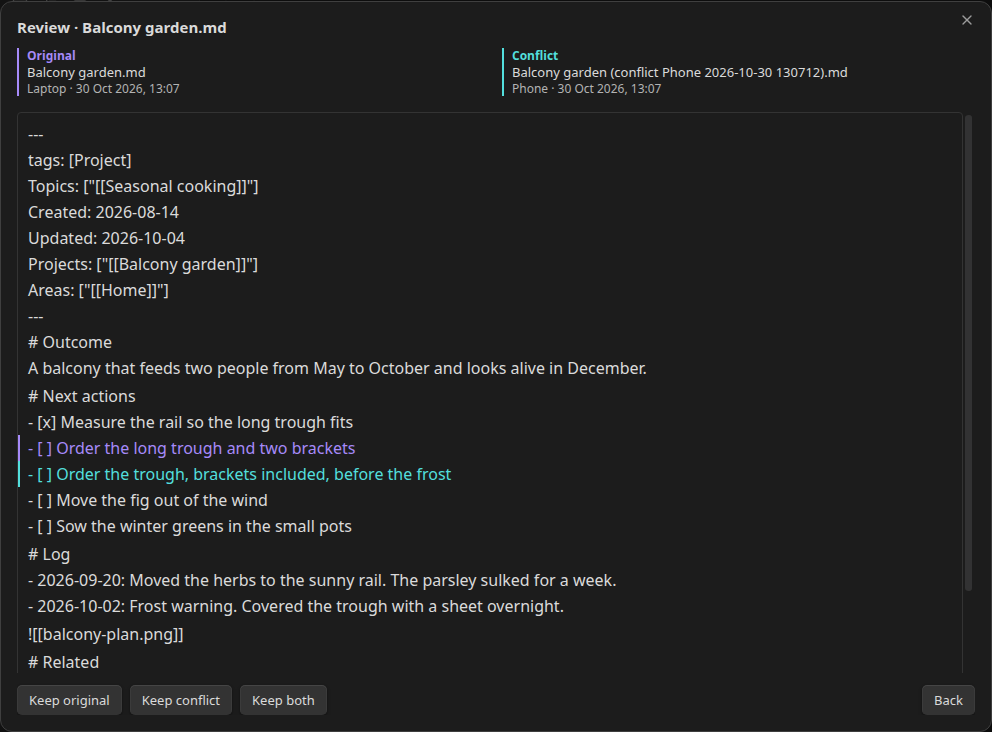
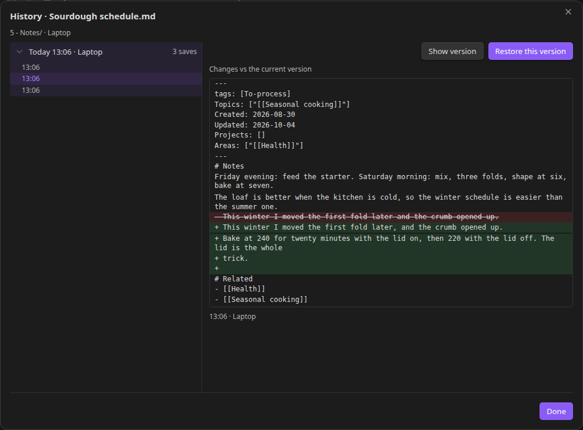
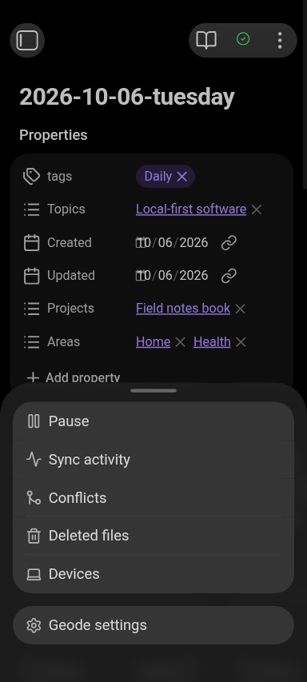
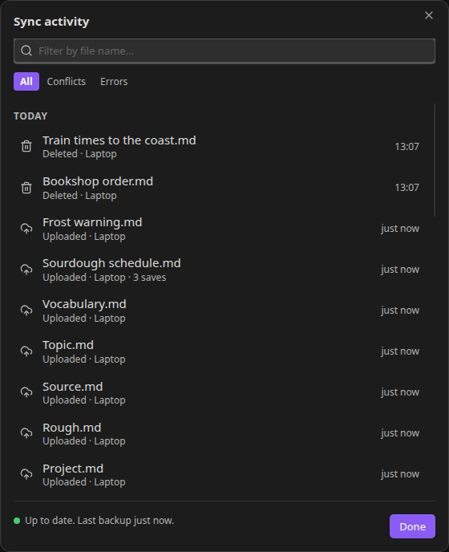
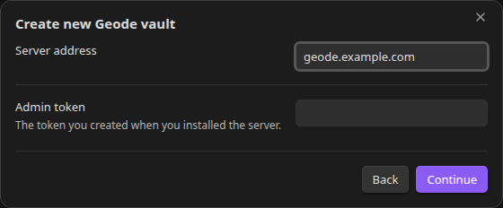

<p align="center">
  
</p>

# Geode

Geode syncs Obsidian vaults between your devices through a server you run yourself. Each device
encrypts your notes before sending them, so the server stores only encrypted data and never sees
file names or note contents. Edits usually reach your other devices within a few seconds.

## Features

### Sync

- Edits reach your other devices within seconds.
- Syncs desktops and Android phones.
- Edits made offline wait and upload when the connection returns.
- Changes made while Obsidian was closed are picked up the next time you open it.
- Renames and moves are followed, and a note renamed on another device stays open.
- Edits to the same note on two devices merge by themselves.
- When they can't merge, both versions are kept for review, side by side, with **Keep original**,
  **Keep conflict** and **Keep both**.
- A mass delete is held instead of applied: sync pauses, and you restore the missing files or confirm
  the delete.
- Selective sync: leave folders out, and choose which Obsidian settings and community plugins follow
  the vault.





*Taken on plugin v0.41.7.*

### Recovery

- File history for every note, with a diff against the current version and a restore. It works for
  attachments too, follows renames, and is in each file's context menu.
- Deleted files are kept for 30 days, so you can restore one or delete it forever.
- Export a decrypted copy of the vault to a folder (desktop).
- Resync from scratch when a device has drifted.
- Rejoining over an existing folder keeps the local files the server doesn't know in a
  `Geode backup` folder inside the vault, instead of uploading them over your notes.



*Taken on plugin v0.41.7.*

### Seeing what is happening

- A status icon for synced, syncing, offline, paused, locked, in conflict or on hold. Its menu has
  pause and resume, sync activity, conflicts, deleted files, devices and settings.
- Sync activity: what changed, one row per file, with the device and the time.
- Settings shows the space the vault uses on the server, when it last backed up, and buttons to push
  or reconcile now.
- The devices on the vault, with revoke for a lost or stolen one.
- Banners when something needs you: an error, a pause, or a plugin update.
- Debug logging with **Copy logs**, for a bug report.



*Taken on plugin v0.41.7.*



*Taken on plugin v0.41.7.*

### Security and setup

- End-to-end encryption: each device encrypts your notes, so the server never sees note contents or
  file names.
- A setup wizard that creates a vault or joins an existing one.
- Lock and auto-lock: lock the vault now, or let it lock itself after a set number of idle hours.
- Change the passphrase at any time. Geode estimates the run first, and resumes it if it is
  interrupted.
- Choose the encryption strength per vault, from the wizard or later in settings.
- Rotate the admin token with a script on your server, rename or leave the vault, and change
  the server address.
- Self-hosted: a VPS or a computer at home, with Tailscale for access from outside.
- No telemetry.



*Taken on plugin v0.41.7.*

Every other screen, and the command that reshoots them all: [`docs/screenshots/README.md`](docs/screenshots/README.md).

## Requirements

- A server running Debian or Ubuntu (x86_64 or ARM64). The smallest VPS plan is enough, and a
  computer at home works too.
- Obsidian 1.8.7 or newer on each device. Geode is tested on desktop (Windows, macOS, Linux) and on
  Android. iOS is not tested yet.
- The admin token the server creates during install. You need it to add devices.

Use one sync tool per vault. Don't sync a Geode vault with iCloud or Google Drive at the same time.

## Install the server

### On a VPS with a domain

1. At your DNS provider, add an A record that points your domain at the VPS IP address, and delete
   any AAAA record for the same name. Caddy gets its certificate for the address DNS hands out, so a
   leftover IPv6 record pointing at an old server stops HTTPS. Check what the name resolves to:

   ```bash
   sudo apt install dnsutils          # once, for dig
   dig +short A geode.example.com     # the VPS IP address
   dig +short AAAA geode.example.com  # prints nothing when the name has no IPv6 record
   ```

2. Connect to the VPS over SSH and run:

   ```bash
   git clone https://github.com/Hrt-Htk/geode.git
   cd geode
   sudo GEODE_DOMAIN=geode.example.com bash deploy/install.sh
   ```

   The script installs Deno and Caddy, installs the generated Caddy config, creates the admin token
   and starts Geode as a systemd service. It downloads only what the server runs, not the
   development toolchain.

3. Geode uses ports 80 and 443.
4. Print the admin token and keep it somewhere safe. The installer shows only the start of it:

   ```bash
   sudo bash deploy/print-admin-token.sh
   ```

5. Open `https://geode.example.com/version` in a browser. It shows the server version. If it fails
   with a TLS error, Caddy is still getting the certificate: open it again after 15 seconds. If it
   keeps failing, work down this list and open it again after each fix: does `dig +short A
   geode.example.com` show the VPS IP address, does `dig +short AAAA geode.example.com` print
   anything, does your provider's firewall or security group allow ports 80 and 443?
6. Check that the server answers as an admin, not just that it is up. This is the request the plugin
   makes when it lists vaults, so it also proves the admin token and the database work:

   ```bash
   curl -s -H "Authorization: Bearer $(sudo cat /opt/geode/.admin-token)" \
     http://127.0.0.1:8080/vaults
   ```

   `[]` is the right answer on a fresh server: the database holds no vaults yet. After the setup
   wizard it lists your vault instead.

Use `wss://geode.example.com` as the server address. `geode.example.com` works too, because the
wizard adds the scheme.

Geode and Caddy both start again after a reboot.

### On a computer at home

Run the same install script without `GEODE_DOMAIN`. Geode then listens on `0.0.0.0:8080`.

On your home network, use `http://192.168.1.20:8080` as the server address, with your server's LAN
IP in place of `192.168.1.20` (`ip addr` shows it). Plain `http` is fine inside your own network.
Open `http://192.168.1.20:8080/version` in a browser to check the server: it shows the server
version. The admin `curl` from the domain steps works here too: run it on the server itself.

To reach the server from outside your home, use [Tailscale](https://tailscale.com). Install it on
the server and on every device, then use `http://TAILSCALE_IP:8080` as the server address.
Tailscale encrypts the traffic between your devices.

Never open port 8080 to the internet.

Phones connecting to a plain `http` address have not been tested yet. If your phone can't connect,
use the domain setup with HTTPS.

## Install the plugin

### With BRAT

BRAT is a community plugin that installs other plugins from a GitHub repository.

1. In Obsidian, open **Settings → Community plugins → Browse**, search for BRAT, then install and
   enable it.
2. In BRAT's settings, open **Beta plugins → Add beta plugin**, paste
   `https://github.com/Hrt-Htk/geode` and click **Add**.
3. Enable Geode, either in BRAT or under **Settings → Community plugins**.

### By hand

1. Download `main.js`, `manifest.json` and `styles.css` from the
   [latest release](https://github.com/Hrt-Htk/geode/releases/latest).
2. Create the folder `<vault>/.obsidian/plugins/geode/`.
3. Put the three files in it, then enable Geode under **Settings → Community plugins**.

Desktop only: phone file apps hide the `.obsidian` folder, so on a phone, use BRAT.

## Set up the first device

1. Open **Settings → Geode** and click **Run setup wizard**.
2. Choose **Create a new vault**.
3. Enter the server address and the admin token, then click **Continue**.
4. Enter a vault name and a passphrase, then the passphrase again under **Confirm passphrase**. The
   device name is already filled in.
5. Pick an **Encryption strength**. **Standard (default)** suits most devices; **Lower** is faster
   on phones, and **Higher** may fail on older phones. Every device on the vault uses it. You can
   change it later under **Settings → Geode → Advanced → Encryption strength**.
6. Click **Create vault**. Sync is running once the wizard shows **Connected. Your vault is
   syncing.** Click **Done** to close the wizard.

The passphrase encrypts your notes and needs at least 12 characters. It is never sent to the server,
so nobody can reset or recover it. If you lose it, the data on the server can't be decrypted. Notes
already on your devices stay readable.

## Add another device

Install the plugin fresh on each device. Don't copy the vault folder from another device:
`.obsidian/plugins/geode/` holds the device identity, and two devices sharing one identity cause
replay loops and false conflicts.

1. Install the plugin as above.
2. Open **Settings → Geode → Run setup wizard** and choose **Join an existing vault**.
3. Enter the same server address and admin token, then click **Load vaults**.
4. Pick your vault and enter the same passphrase as on the first device.
5. Click **Join**. Your notes start downloading; click **Done** to close the wizard.

The admin token is long. On a phone, paste it instead of typing it, for example from a password
manager.

**Rejoining over an old copy.** A device that still holds this vault and its Geode data (a revoked
device, a device that was offline for months) joins the same way, and Geode makes it match the server
instead of pushing the old folder back:

- Notes you did not change on that device take the server version. Deletes and moves made on another
  device apply here too.
- Notes you did change on that device keep their normal merge, and a note edited on both sides becomes a
  conflict you resolve as usual.
- Files Geode cannot match to anything on the server, such as notes written on that device while it was
  offline, are moved to a `Geode backup` folder inside the vault instead of uploaded. That folder never
  syncs, on any device.

The setup wizard warns you before the join runs and reports how many files it kept. This needs the
device's Geode data: a recovery that wiped it (a fresh plugin folder) leaves nothing to compare, and that
join uploads the folder as new notes, so remove the old files first.

If you already copied a vault folder and see conflicts or replay loops, run the setup wizard on that
device and join again. It gets a new identity, and your passphrase still works.

## Update

The plugin and server don't need to run the same version. When versions differ, sync keeps working
and Geode's settings show **Plugin update available** or **Server update available**. Sync stops
only when the wire protocol changed or the server requires a newer plugin. The settings then show
**Update required** or **Server update required**. Update the side the message names, then reload
Obsidian.

**Server:** from the `geode` folder on the server, pull the new code and run the install script
again. It keeps your data and admin token, and it installs `/etc/caddy/Caddyfile` and reloads Caddy,
so Caddy fixes in a release reach a server that is already running. It only replaces that file when
Geode owns it: it is missing, it is what an earlier install generated, or it starts with Geode's
`# Managed by Geode` line, so on a server whose Caddyfile also serves other sites the installer
leaves it alone and prints the `cp` line that adds the Geode block.

```bash
cd geode
git pull --ff-only
sudo GEODE_DOMAIN=geode.example.com bash deploy/install.sh
```

For a home server, leave out `GEODE_DOMAIN`.

**Plugin:** in BRAT's settings, click **Update** next to Geode, or replace the three files with the
ones from the latest release.

## Backup and restore

The server keeps everything in `/opt/geode/data`: a SQLite database and the encrypted blobs. The
data is encrypted, so you can store backups anywhere, such as another computer, a USB drive or
object storage. The database itself is not: it holds vault names and device tokens, so keep a
backup about as private as the server.

Back up regularly with a consistent copy of the database plus the blobs:

```bash
sudo apt install sqlite3 rsync   # once, for the database copy and the blobs
sudo mkdir -p /srv/geode-backup
sudo sqlite3 /opt/geode/data/geode.db ".backup /srv/geode-backup/geode.db"
sudo rsync -a --no-o --no-g --no-p --exclude 'geode.db*' /opt/geode/data/ /srv/geode-backup/
```

Keep `--no-o --no-g --no-p`: `rsync -a` also copies the source directory's owner and mode onto the
destination, which leaves `/srv/geode-backup` owned by `geode` with mode `700`, unreadable by any
other user or backup job. The flags leave the backup directory's own attributes alone.

To restore, stop the service, copy the backup over `data/` and delete what the backup does not have:

```bash
sudo systemctl stop geode
sudo rsync -a --delete --no-o --no-g --no-p /srv/geode-backup/ /opt/geode/data/
sudo chown -R geode:geode /opt/geode/data
sudo systemctl start geode
```

`--delete` is what makes the restore restore. A running server keeps its newest changes in
`geode.db-wal` beside the database, and SQLite replays that file over whatever database it finds, so
a restore that leaves the old `-wal` in place comes back holding the *newer* state even though the
restored `geode.db` is the backup's. `--delete` removes `geode.db-wal` and `geode.db-shm`, and with
them the blobs of files and vaults created after the backup: the server then serves exactly the
backup's state. If you would rather keep those blobs, delete `geode.db`, `geode.db-wal` and
`geode.db-shm` yourself and copy without `--delete`; the leftover blobs stay on disk unreferenced.

Then check what the server actually serves. `[]` is correct when the backup held no vaults;
otherwise it lists the vaults the backup contained:

```bash
curl -s -H "Authorization: Bearer $(sudo cat /opt/geode/.admin-token)" \
  http://127.0.0.1:8080/vaults
```

Try a restore at least once so you know the backup works. Full procedure:
[`docs/testing/strategy.md`](./docs/testing/strategy.md) §6.

## Admin token

The admin token lets you add devices and manage the server. Keep it private, like a password.

- Print it: `sudo bash deploy/print-admin-token.sh`. This is the only place the whole token is
  shown: `deploy/install.sh` prints its first four characters, so an install log or a screenshot of
  the install output does not hand out the token.
- Rotate it: `sudo bash deploy/rotate-admin-token.sh`. The old token stops working. Existing devices
  keep syncing; use the new token to join devices and for admin actions.

## Lost or stolen device

A device that has joined the vault can read and change your notes until you revoke it.

1. In Obsidian, open **Settings → Geode → Devices → Manage**.
2. Click **Revoke** next to the lost device and enter the admin token when asked.

The device can no longer sync from that moment. If you get it back, join it again like a new
device.

## Uninstall

**Server:**

```bash
sudo systemctl disable --now geode
sudo rm -rf /opt/geode /etc/systemd/system/geode.service /etc/geode
sudo systemctl daemon-reload
sudo userdel geode
```

Geode's site stays in `/etc/caddy/Caddyfile`, so Caddy keeps the domain and answers 502. Remove the
Geode block, or put back the Caddyfile Caddy shipped with, then reload:

```bash
sudo systemctl reload caddy
```

**Plugin:** disable Geode under **Settings → Community plugins**, then delete the
`<vault>/.obsidian/plugins/geode/` folder.

## Troubleshooting

| Problem | What to do |
|---------|------------|
| Can't reach the server | Check the service with `sudo systemctl status geode` and its logs with `journalctl -u geode -f`. Then query the server: `curl -v https://geode.example.com/version` (home server: `curl -v http://192.168.1.20:8080/version`). It should answer with JSON that includes the server version. If it does, check that an admin request works: `curl -s -H "Authorization: Bearer $(sudo cat /opt/geode/.admin-token)" http://127.0.0.1:8080/vaults` answers `[]` or your vaults. |
| "That admin token isn't valid" | Print the token again with `deploy/print-admin-token.sh` and paste it exactly. |
| Wrong passphrase when joining | Geode rejects it right away. Passphrases are case sensitive. |
| Notes don't appear after joining | Give the first sync a moment. If nothing arrives, run **Geode: Resync from scratch** from the command palette. |
| Replay loops or repeated conflicts after copying a vault | Two devices share one identity. See [Add another device](#add-another-device). |
| "Update required" or "Server update required" | See [Update](#update). |

## Network use

Geode has one remote service: the Geode server you run yourself. The setup wizard asks for its
address, and every request the plugin makes goes to that address and nowhere else.

- **Sync.** The plugin keeps one WebSocket open to `/vaults/<id>/sync` and reports each change
  there. Encrypted chunks go over HTTP to `/blobs` on the same host, and the reads behind history and
  catch-up come back the same way. A server with a domain gets `wss://` and `https://`; a server on
  your home network gets `ws://` and `http://`.
- **The rest of the plugin.** Creating and listing vaults, joining one, file history, restore, the
  deleted-files list and the space figure in settings are calls to the same address.
- **Update notices.** Your own server reports a version mismatch when the plugin connects. The plugin
  reads no update feed of its own; updating is BRAT's job, or the download in
  [Install the plugin](#install-the-plugin).

The server receives:

- Encrypted chunks of your notes and attachments. A chunk is named by the hash of its plaintext:
  that is how the server skips a chunk it already holds, and how it can tell which files share
  content.
- A keyed hash of each file path, plus each path and its metadata under the vault key.
- The vault and device names, and the size and time of every edit.

It never receives note contents or file names in the clear.

There is no telemetry, no analytics, no crash reporting and no third-party service: no CDN, no font
or icon host, no update endpoint of its own. Those are the only network calls the plugin makes.

## Privacy and security

- Each device encrypts your notes with a key derived from your passphrase before anything is sent.
- Keys are kept in Obsidian's storage on each device. Copying the vault folder does not copy them.
- The server's web log drops the WebSocket protocol header that carries each device token, so tokens
  never reach the log.
- Use a strong passphrase. Anyone holding a device token, or the server's data, can try passphrases
  offline against your encrypted notes, and only the passphrase's strength stops them. If a device is
  lost, revoke it and change the passphrase.
- This device's sync token and a plaintext list of your file paths live in the plugin's own folder,
  inside your Obsidian config directory (`plugins/geode/`). Geode never syncs that folder, but it must
  stay on the device: another sync tool that copies your config directory would carry the token to its
  server. Keep one sync tool per vault.

Found a security problem? Report it privately, not in a public issue: [`SECURITY.md`](./SECURITY.md).

## Limits

- One person per vault. Geode is not built for sharing a vault between people.
- No live collaborative editing. When two devices change the same note, Geode merges the changes,
  or keeps both versions in a conflict file when it can't.
- One sync tool per vault (see [Requirements](#requirements)).
- One vault stores at most **20 GiB** on the server by default: its chunks plus the metadata of every
  change it keeps. Past that, uploads and trash restores are refused (blob POST answers `507`, a commit
  or restore `storage_full`). Deleting frees space only once compaction and blob garbage collection
  have run, so the quick way back is a bigger cap: set `GEODE_VAULT_MAX_BYTES` (bytes) with
  `sudo systemctl edit geode` (not in `/etc/geode/geode.env`, which `deploy/install.sh` rewrites) and
  restart the service. On a server installed before this option existed, re-run `deploy/install.sh`
  first (or add the name to the unit's `--allow-env`), because `deploy/deploy.sh` does not rewrite the
  unit; the server logs the cap it actually uses at startup. A commit is also bounded per file: 10 000
  chunks, 64 KB of encrypted metadata and 8 KB of encrypted path. At the chunker's 256 KB average that
  caps a single file at about **2.5 GB** (640 MB if every chunk were the 64 KB minimum, 10 GB if every
  chunk hit the 1 MB maximum), and a larger file cannot be committed.

## How it is built

- **Server:** Deno, SQLite and a blob store on disk, behind Caddy for HTTPS.
- **Plugin:** TypeScript, libsodium for encryption, FastCDC for chunking and `node-diff3` for
  merging.
- The encryption and chunking code is shared by the server and the plugin.

`main.js` is about 3.5 MB because it is the whole plugin in one file: the sync engine and every
library it runs on, bundled by `deno task build:plugin` (`scripts/plugin-build.ts`, esbuild). More
than half of the size is libsodium, which arrives as WebAssembly inlined as base64. An Electron
window never finishes fetching a separate `.wasm` file, so the build extracts the WebAssembly module
from libsodium's own JavaScript, inlines it, and patches libsodium to start from those bytes
synchronously. Nothing is loaded from the network when the plugin runs.

## Contributing

Architecture and build order: [`docs/architecture/overview.md`](./docs/architecture/overview.md).
Index of all documents: [`docs/README.md`](./docs/README.md).
Contribution rules: [`CONTRIBUTING.md`](./CONTRIBUTING.md).

## License

Apache-2.0. See [`LICENSE`](./LICENSE).
