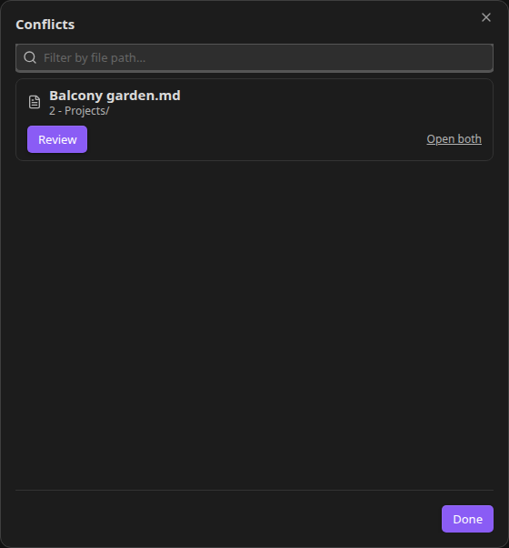
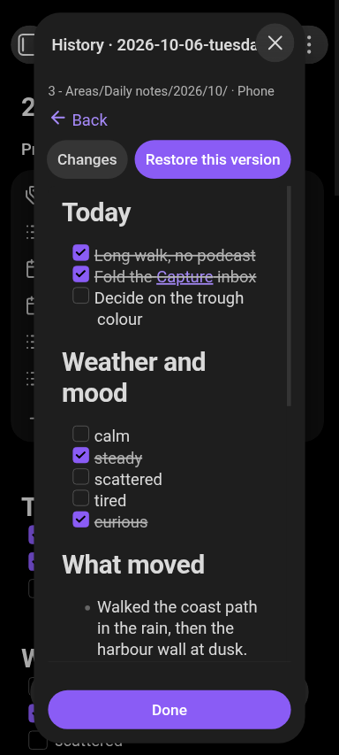
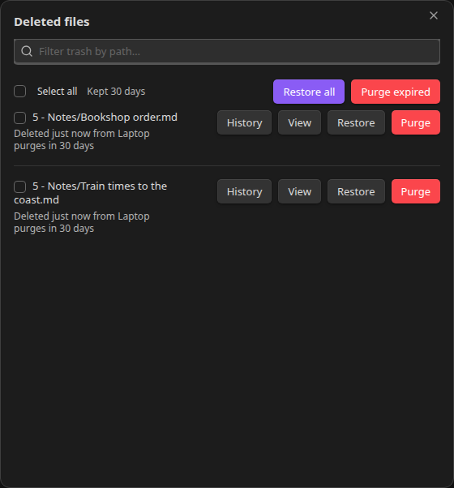
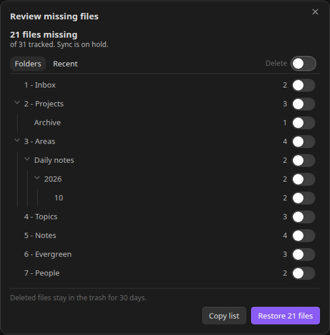
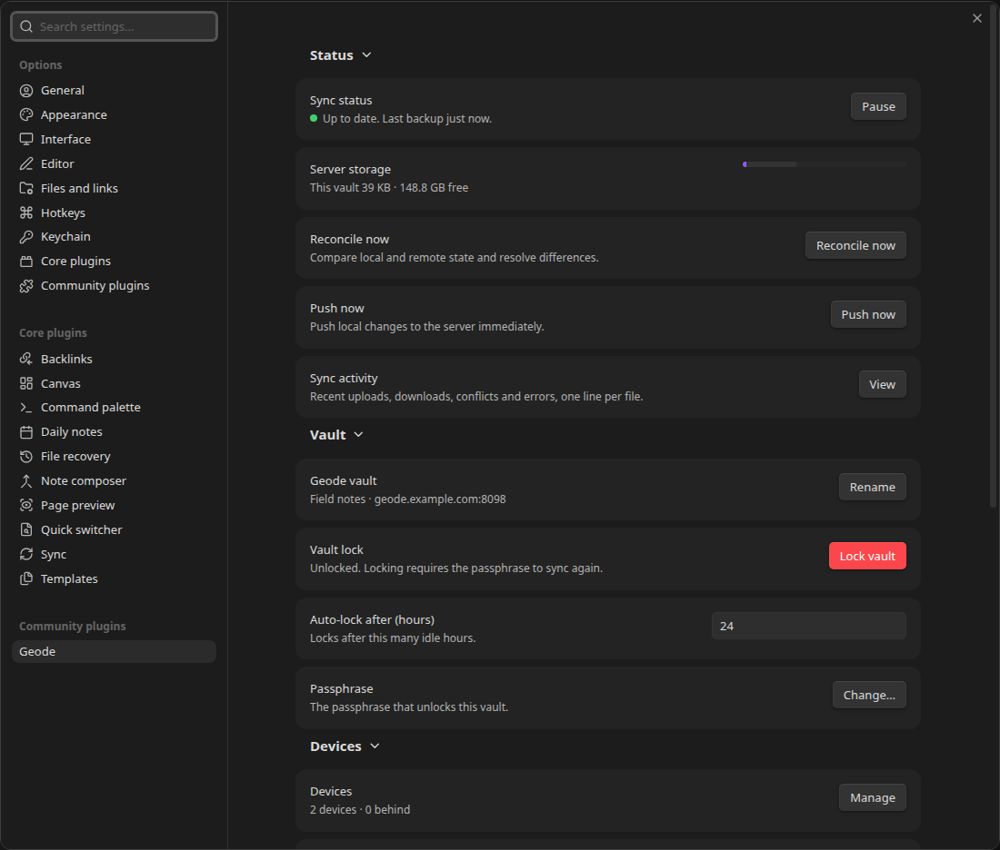
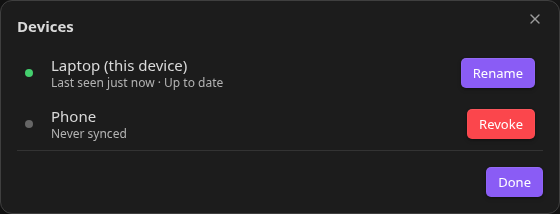
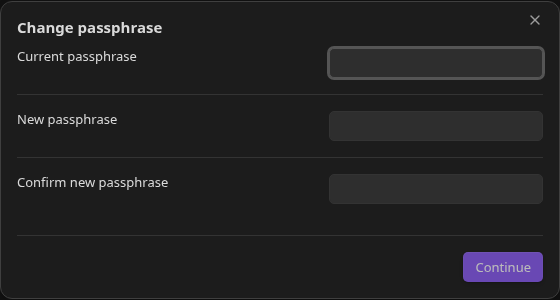
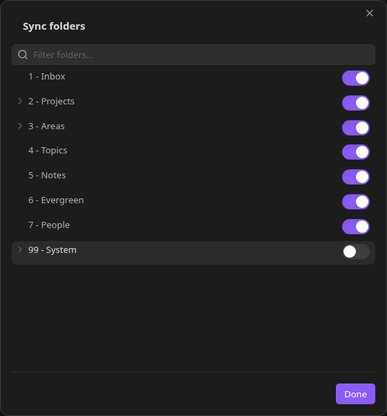
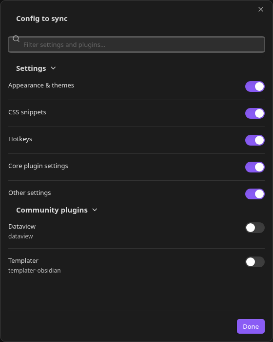

# Screenshots

Every image here was taken in real Obsidian, on the desktop and on an Android phone, from a demo
vault of invented notes (`test/e2e/fixtures/demo-vault`): no personal note, name or place appears in
any of them. They use Obsidian's own default theme in dark mode, at a fixed window size, and the two
device names the demo vault syncs between, Laptop and Phone.

`deno task docs:screenshots` reshoots all of them in one run (desktop and the connected phone) and
stamps the plugin version into every caption, here and in `../../README.md`, so the version a picture
was taken on is never out of date. An image whose version differs from the current plugin was taken
before the latest changes.

## Sync

*The conflict review window. Both devices changed the same line, so Geode kept both versions and
asks which one to keep. Taken on plugin v0.41.7.*

*Conflicts waiting for a decision, from the status icon's menu. Taken on plugin v0.41.7.*

## Recovery

*File history. Each period is one device's run of saves; the selected version is diffed against the
note as it is now, and Restore this version brings it back. Taken on plugin v0.41.7.*

*The same history on the phone, where the period list and the preview stack instead of sitting side by
side. Taken on plugin v0.41.7.*

*Deleted files stay restorable for 30 days before Geode purges them. Taken on plugin v0.41.7.*

*When many files disappear at once, sync holds instead of deleting them everywhere. You review what
went missing, then restore it or confirm the delete. Taken on plugin v0.41.7.*

## Seeing what is happening

*The status icon on the phone, with its menu: pause, sync activity, conflicts, deleted files, devices
and settings. Taken on plugin v0.41.7.*

*Sync activity: one row per file, the newest first, with the device that changed it. Taken on plugin v0.41.7.*

*The settings tab: status, server storage, and the vault rows. Taken on plugin v0.41.7.*

*The devices on the vault, with revoke for a lost or stolen one. Taken on plugin v0.41.7.*

## Security and setup

*The setup wizard: one server and admin token per vault, then a passphrase. Taken on plugin v0.41.7.*

*A new passphrase re-encrypts the vault. Geode estimates the run first and resumes it if it is
interrupted. Taken on plugin v0.41.7.*

## Selective sync

*Folders left out of sync stay on the device that has them. Taken on plugin v0.41.7.*

*Which Obsidian settings and community plugins follow the vault. Taken on plugin v0.41.7.*
